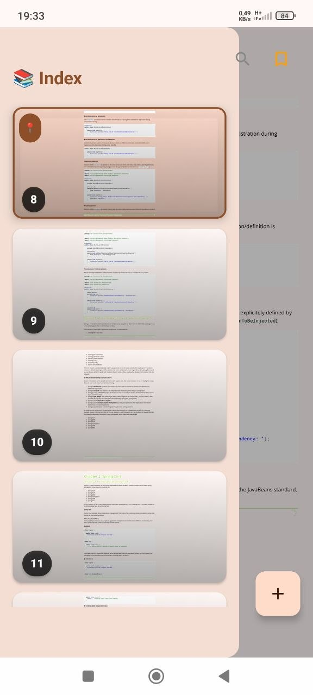
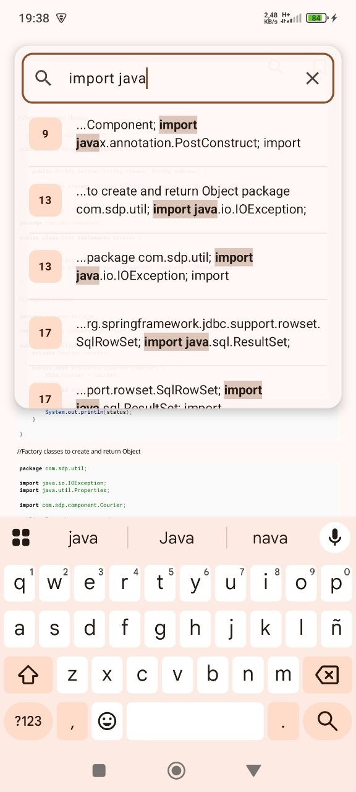
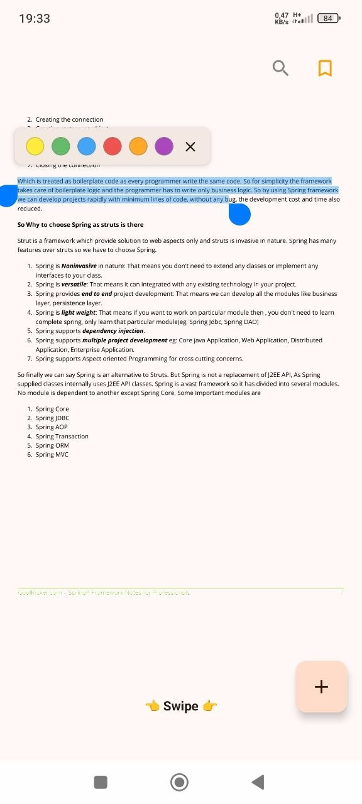
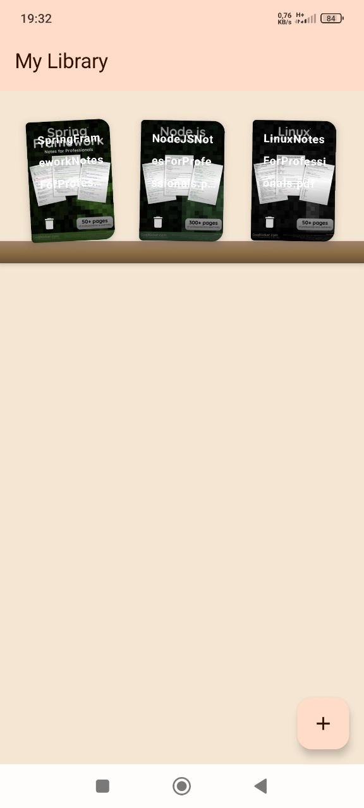

# PDF Viewer Compose

[](https://central.sonatype.com/artifact/io.github.fmaestre98/pdfviewer-compose)
[](LICENSE)
[](https://android-arsenal.com/api?level=24)
[](https://developer.android.com/compose)

A complete PDF reader for Android as a single Jetpack Compose function. Drop `PdfReaderView` into your app and get zoom, text selection (across pages), highlights, bookmarks, page notes, search, thumbnails and reading progress, all persisted out of the box.

```kotlin
PdfReaderView(source = PdfSource.FromUri(uri), onClose = onBack)
```

---

## Screenshots

<p align="center">
  
  
  
</p>
<p align="center">
  
  
  
</p>

---

## Features

*   **Rendering and gestures**: horizontal paging or continuous vertical scrolling, pinch-to-zoom, pan and double-tap zoom.
*   **Text selection**: long press to select, drag handles (even across page boundaries), copy to the clipboard.
*   **Highlights**: highlight the selection in several colors. Rectangles are stored normalized, so they render correctly at any zoom level or screen size.
*   **Bookmarks and page notes**: bookmark pages and attach text notes to any page.
*   **Search**: full-text search across the document.
*   **Thumbnail drawer**: page previews for fast navigation.
*   **Reading progress**: reopens every document on the last read page.
*   **Pluggable persistence**: works with a built-in Room database, or with your own storage through the `PdfViewerStorage` interface.
*   **No DI framework required**: works with or without Hilt/Koin.

---

## Installation

The library is published on Maven Central:

```kotlin
// settings.gradle.kts
dependencyResolutionManagement {
    repositories {
        google()
        mavenCentral()
    }
}

// app/build.gradle.kts
dependencies {
    implementation("io.github.fmaestre98:pdfviewer-compose:1.0.2")
}
```

### Requirements

*   `minSdk` 24 or higher
*   Jetpack Compose with a Material 3 theme around the reader (the SDK uses `MaterialTheme` colors and typography)
*   Kotlin 2.2 recommended (the library is built with Kotlin 2.2.10 and Compose BOM 2024.09)

PDFBox is initialized by the SDK and R8/ProGuard rules are shipped with the AAR, so no extra setup is needed.

---

## Quick start

```kotlin
import com.fmaestre98.pdfviewer.sdk.model.PdfSource
import com.fmaestre98.pdfviewer.sdk.ui.PdfReaderView

@Composable
fun ReaderScreen(pdfUri: Uri, onBack: () -> Unit) {
    PdfReaderView(
        source = PdfSource.FromUri(pdfUri),
        onClose = onBack
    )
}
```

That is all. Highlights, bookmarks, notes and the last read page are saved in an internal SDK database (`pdf_sdk_internal.db`).

### PDF sources

| Source | Usage |
| --- | --- |
| `PdfSource.FromUri(uri)` | `content://` or `file://` URIs, for example from the system file picker or a share intent. Content URIs are cached once in the app cache directory. |
| `PdfSource.FromFile(file)` | A `File` already stored on the device. |
| `PdfSource.FromAsset("docs/manual.pdf")` | A PDF bundled in your app's `assets` folder. |

---

## Configuration

```kotlin
import com.fmaestre98.pdfviewer.sdk.core.model.PdfViewerOrientation
import com.fmaestre98.pdfviewer.sdk.model.PdfViewerColors
import com.fmaestre98.pdfviewer.sdk.model.PdfViewerConfig

PdfReaderView(
    source = PdfSource.FromFile(file),
    documentId = "book-42",
    config = PdfViewerConfig(
        initialPage = null,                                 // null = resume from the last read page
        initialOrientation = PdfViewerOrientation.Vertical, // Horizontal by default
        enableAnnotations = true,                           // highlights and page notes
        enableBookmarks = true,
        enableSearch = true,
        enableThumbnailDrawer = true,
        colors = PdfViewerColors(
            selectionHighlight = Color(0x40FF9800),
            selectionHandle = Color(0xFFFF9800)
        )
    ),
    onClose = { navController.popBackStack() }
)
```

`documentId` is the key used to store annotations and reading progress. By default it comes from the source (the URI string, the file's absolute path or `asset://<path>`). Pass your own stable ID if the file location can change, for example a database primary key.

---

## Using your own database (optional)

To keep bookmarks, highlights, notes and reading progress in your app's database, implement `PdfViewerStorage` and pass it to the reader:

```kotlin
class MyPdfViewerStorage(
    private val dao: MyAnnotationsDao
) : PdfViewerStorage {
    override suspend fun getBookmarkedPages(documentId: String): Set<Int> = TODO()
    override suspend fun isPageBookmarked(documentId: String, page: Int): Boolean = TODO()
    override suspend fun toggleBookmark(documentId: String, page: Int): Boolean = TODO()

    override suspend fun getHighlightsByPage(documentId: String): Map<Int, List<PdfHighlight>> = TODO()
    override suspend fun saveHighlight(
        documentId: String,
        page: Int,
        snippet: String,
        color: String,
        groupId: String,
        rects: List<NormalizedRect>
    ) = TODO()
    override suspend fun deleteHighlight(groupId: String) = TODO()

    override suspend fun getPageNote(documentId: String, page: Int): PdfPageNote? = TODO()
    override suspend fun savePageNote(documentId: String, page: Int, text: String, color: String?) = TODO()
    override suspend fun deletePageNote(documentId: String, page: Int) = TODO()

    override suspend fun getLastReadPage(documentId: String): Int? = TODO()
    override suspend fun saveLastReadPage(documentId: String, page: Int) = TODO()

    // Optional: live updates for annotation list screens
    override fun observeAnnotations(documentId: String): Flow<PdfDocumentAnnotations> = TODO()
}
```

```kotlin
PdfReaderView(
    source = PdfSource.FromUri(uri),
    documentId = bookId,
    storage = myPdfViewerStorage,
    onClose = onBack
)
```

A highlight that spans several pages is saved as one `saveHighlight` call per page, all with the same `groupId`. With Hilt, bind your implementation once:

```kotlin
@Binds
@Singleton
abstract fun bindPdfViewerStorage(impl: MyPdfViewerStorage): PdfViewerStorage
```

[`AppPdfViewerStorage`](sample/src/main/java/com/fmaestre98/pdfviewer/sdk/AppPdfViewerStorage.kt) in the sample app is a complete reference implementation built with Hilt and Room.

---

## Per-document annotations screen (optional)

The SDK includes a ready-made list of the annotations of one document:

```kotlin
val viewModel: AnnotationsViewModel = viewModel(
    factory = AnnotationsViewModel.Factory(documentId = bookId, storage = storage)
)
val state by viewModel.state.collectAsStateWithLifecycle()

AnnotationsScreen(
    state = state,
    onAction = viewModel::onAction
)
```

Collect `viewModel.events` to handle `NavigateToReader(documentId, page)` and `NavigateBack`. The list updates live when the storage overrides `observeAnnotations`.

---

## Public API

| Type | Package | Purpose |
| --- | --- | --- |
| `PdfReaderView` | `sdk.ui` | Full reader composable |
| `PdfSource` | `sdk.model` | Where the PDF comes from |
| `PdfViewerConfig`, `PdfViewerColors` | `sdk.model` | Feature flags, initial page and orientation, colors |
| `PdfViewerOrientation` | `sdk.core.model` | `Horizontal` (paged) or `Vertical` (continuous scroll) |
| `PdfViewerStorage` | `sdk.storage` | Persistence contract |
| `PdfHighlight`, `PdfPageNote`, `PdfBookmark`, `NormalizedRect`, `PdfDocumentAnnotations` | `sdk.storage` | Storage models |
| `RoomPdfViewerStorage`, `rememberDefaultPdfViewerStorage()` | `sdk.storage` | Default storage |
| `AnnotationsScreen`, `AnnotationsViewModel` | `sdk.ui.annotations` | Optional annotations list |
| `PdfRendererManager` | `sdk.core.rendering` | Page bitmap rendering, for example for cover thumbnails |

All packages are relative to `com.fmaestre98.pdfviewer`. Everything else is `internal`.

---

## Sample app

The [`sample`](sample) module shows two integrations:

*   **Minimal example** ([`MinimalSampleActivity`](sample/src/main/java/com/fmaestre98/pdfviewer/minimal/MinimalSampleActivity.kt)): a plain `ComponentActivity` with no dependency injection that opens a bundled PDF with the default storage. Open it from the play button in the home screen's top bar.
*   **Full app**: a bookshelf library with Hilt, its own Room database (`AppPdfViewerStorage`) and a global annotations screen across all books.

The sample depends on the library source (`implementation(project(":pdfviewer-sdk"))`), so it always runs the current code.

---

## Project structure

```
pdfviewer-compose/
├── pdfviewer-sdk/          # The library (the only published artifact)
│   └── com.fmaestre98.pdfviewer.sdk
│       ├── ui/             # PdfReaderView, annotations screen, reader internals
│       ├── model/          # PdfSource, PdfViewerConfig, PdfViewerColors
│       ├── storage/        # PdfViewerStorage contract + default Room implementation
│       ├── data/           # Internal Room database used by the default storage
│       └── core/           # Internal engine: rendering, gestures, overlays, text, search
├── sample/                 # Example app
├── gradle/libs.versions.toml
└── CHANGELOG.md
```

The reader follows the **MVI** pattern: the UI emits actions, the ViewModel talks to `PdfViewerStorage` and updates an immutable state, and one-time effects go through an events channel.

---

## Building locally

Requirements: Android Studio (latest stable), JDK 17 and Android SDK 36.

```bash
git clone https://github.com/fmaestre98/pdfviewer-compose.git
cd pdfviewer-compose
./gradlew :sample:installDebug             # run the sample app
./gradlew :pdfviewer-sdk:publishToMavenLocal  # try the artifact in another local project via mavenLocal()
```


## License

This project is licensed under the MIT License. See the [LICENSE](LICENSE) file for details.

Copyright (c) 2026 Fabian Ortiz
